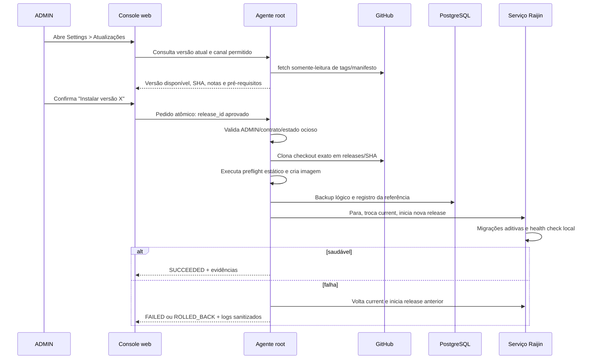

# Plano — atualização administrada pela console e renomeação da plataforma

**Status:** proposta para discussão. Este documento não autoriza alteração na
VM, no bootstrap, nos serviços ou no repositório de produção.

## 1. Objetivo

Permitir que um ADMIN veja se há uma versão aprovada do Raijin disponível no
GitHub e inicie sua instalação pela console web, sem acesso SSH à VM do
cliente. Ao mesmo tempo, estabelecer `raijin-data-migration` como nome
canônico da instalação, eliminando `s3-oci-migration` dos novos bootstraps.

O ambiente de homologação atual será preservado como legado até ser destruído.
A validação principal da renomeação ocorrerá em uma VM nova, criada do zero.
Não é recomendado renomear a instalação existente in-place: isto misturaria
uma alteração de identidade operacional com a validação do atualizador e
aumentaria o risco para volumes e backups existentes.

## 2. Decisões propostas

| Tema | Proposta | Motivo |
| --- | --- | --- |
| Quem atualiza | Somente ADMIN inicia uma atualização. | Não delegar alteração de código a OPERATOR/VIEWER. |
| Automação | Verificação pode ser periódica; aplicação é sempre manual e confirmada. | Evita mudança inesperada em uma migration ativa. |
| Canal | Releases imutáveis e aprovadas, identificadas por tag Git assinada ou commit SHA allowlisted. | `main` não é uma fronteira de segurança nem de estabilidade. |
| Origem | GitHub por chave de deploy somente-leitura, exclusiva da VM. | Não usar senha/PAT de usuário nem chave do operador. |
| Privilégio | A web solicita; um agente root no host valida e executa. | O container web não recebe acesso a systemd, Podman, Git ou `/etc`. |
| Disponibilidade | Atualização controlada com parada breve, backup prévio, health check e rollback. | O modelo atual é uma aplicação monolítica em uma VM. |
| Instalação nova | Usar apenas nomes `raijin-data-migration`. | Evita perpetuar o nome anterior. |
| Instalação antiga | Não renomear automaticamente. Manter operável até o desligamento planejado. | Evita movimentação destrutiva de dados. |

As decisões que precisam de aceite antes da implementação são: formato final
do canal de release (tag assinada é recomendado), política de manutenção da
VM durante atualização e prazo de retenção das releases/artefatos locais.

## 3. Arquitetura proposta

```mermaid
flowchart LR
    A[ADMIN autenticado] -->|consulta / confirma| UI[Console Raijin]
    UI --> API[API autorizada ADMIN]
    API -->|pedido limitado e atômico| Q[(Update control queue)]
    T[raijin-update-agent<br/>root + systemd] -->|lê e valida| Q
    T --> G[GitHub<br/>deploy key read-only]
    T --> R[/opt/raijin-data-migration/releases/SHA]
    T --> B[Backup lógico PostgreSQL]
    T --> S[raijin-data-migration.service]
    S --> H[Health check local HTTPS]
    H -->|sucesso| C[/current -> nova release]
    H -->|falha| RB[Rollback para release anterior]
    T --> E[(Evidência de atualização)]
    API --> E
```

O agente de atualização deve ser o único processo com permissão para:

- acessar a chave de deploy do GitHub;
- criar diretórios de release e modificar o link `current`;
- chamar `systemctl`, Podman e o backup PostgreSQL;
- gravar o estado operacional em `/var/lib/raijin-data-migration`.

A API web nunca recebe shell, caminho de arquivo, URL Git arbitrária, branch
arbitrária, parâmetro de Podman ou comando de systemd vindo do navegador.

## 4. Nomes canônicos da instalação nova

| Recurso | Nome novo |
| --- | --- |
| Serviço principal | `raijin-data-migration.service` |
| Agente de atualização | `raijin-update-agent.service` e timer correspondente |
| Diretório de releases | `/opt/raijin-data-migration/releases/<commit-sha>` |
| Release ativa | `/opt/raijin-data-migration/current` (symlink) |
| Configuração e segredos | `/etc/raijin-data-migration/` |
| Dados persistentes e backups | `/var/lib/raijin-data-migration/` |
| Estado temporário | `/run/raijin-data-migration/` |
| Rede Podman | `raijin-data-migration` |
| Imagem local | `localhost/raijin-data-migration:<commit-sha>` |
| Containers | `raijin-postgres`, `raijin-app`, `raijin-raikou-*`, `raijin-transfer-worker` |

O bootstrap novo não deve criar aliases `s3-oci-migration`. A documentação,
unidades systemd, timers, scripts, network, imagens, volumes e caminhos devem
usar somente o nome novo.

### 4.1 Compatibilidade com a VM atual

O código de atualização pode ter um adaptador temporário para reconhecer uma
instalação antiga, mas ele não deve mover `/etc/s3-oci-migration`,
`/var/lib/s3-oci-migration`, volumes ou containers automaticamente. Enquanto
a VM atual existir, seus backups e recuperação continuam usando os nomes que
já possuem. A remoção será feita no procedimento explícito de destruição da
VM, após preservar as evidências necessárias.

## 5. Fluxo de atualização



### 5.1 Estados persistidos

`IDLE`, `CHECKING`, `AVAILABLE`, `REQUESTED`, `PREFLIGHT`, `BACKING_UP`,
`DEPLOYING`, `VERIFYING`, `SUCCEEDED`, `FAILED`, `ROLLING_BACK` e
`ROLLED_BACK`.

Cada operação terá `operation_id`, release anterior, release alvo, SHA,
início/fim, resultado, motivo sanitizado e referência do backup. Não registrar
tokens GitHub, passwords, conteúdos de Secrets ou cabeçalhos HTTP.

### 5.2 Pré-condições obrigatórias

1. Usuário solicitante é ADMIN e possui sessão/CSRF válidos.
2. Não existe atualização em andamento.
3. A release alvo pertence ao canal configurado e seu SHA confere com o
   manifesto/tag aprovado.
4. Há espaço livre para imagem nova, checkout, backup e retenção mínima.
5. PostgreSQL, backup lógico e health da release atual estão saudáveis.
6. A fila está drenada ou existe confirmação administrativa explícita de
   janela de indisponibilidade. A primeira versão deve rejeitar atualização
   com transferências/restores ativos.
7. A configuração local, permissões e chave de deploy passam no preflight.

## 6. Interface de Settings

Nova seção ADMIN, separada de usuários e endpoint da console:

- versão em execução: tag, SHA curto, data de instalação e canal;
- botão `Verificar atualizações`;
- versão disponível, notas resumidas, mudanças de schema declaradas e impacto
  de indisponibilidade;
- botão `Instalar atualização`, com confirmação que mostra release e backup;
- estado em tempo real, última tentativa, motivo de falha e link para
  evidência sanitizada;
- botão `Tentar rollback` somente quando uma release anterior íntegra existir;
- nenhuma edição de URL do repositório, shell, caminho, tag livre ou chave.

OPERATOR e VIEWER não veem a seção e a API retorna `403` para qualquer acesso
direto.

## 7. Agente de host e contrato de segurança

### 7.1 Pedido web → host

O container cria um pedido JSON atômico em diretório dedicado montado com o
menor privilégio possível. O pedido possui somente: `operation_id`, ação
(`check`, `apply`, `rollback`), `release_id` previamente descoberto, ator,
horário e nonce. O agente valida tudo novamente; não confia em campos de
navegador ou container.

O agente grava resultado em arquivo separado, propriedade root, e a API o lê
como somente-leitura. A alternativa equivalente é um socket Unix com protocolo
fixo; a escolha deve ser feita na implementação. Em ambos os casos, não haverá
montagem de `/run/systemd`, socket Podman, `/etc` ou chave Git no container.

### 7.2 Chave GitHub

- Chave SSH dedicada, somente leitura, sem passphrase interativa e sem acesso
  a outros repositórios.
- Arquivo root-owned `0600`, por exemplo
  `/etc/raijin-data-migration/github-deploy-key`.
- `known_hosts` fixado para GitHub; rejeitar alteração silenciosa de host key.
- Para repositório público, a chave pode ser dispensada, mas a validação de
  release continua obrigatória.

### 7.3 Rollback

Rollback restaura o symlink `current` para o SHA anterior e reinicia o serviço.
Migrações de banco da primeira versão devem ser estritamente aditivas e
compatíveis com a release anterior. Se uma release futura exigir migração
irreversível, ela deve declarar `rollback_supported=false` antes da confirmação
e exigir procedimento manual aprovado.

## 8. Fases de implementação futura

### P0 — Preparação e contrato

- [ ] Definir formato de release aprovada: tag assinada/manifesto assinado.
- [ ] Definir canal inicial (`stable` recomendado) e política de retenção.
- [ ] Inventariar todas as referências a `s3-oci-migration` em scripts,
      systemd, documentação, Terraform e testes.
- [ ] Definir a política de drenagem e janela máxima de indisponibilidade.
- [ ] Definir se o agente usa spool de arquivos ou socket Unix.

### P1 — Refatoração de identidade sem ativar atualizador

- [ ] Parametrizar os nomes da plataforma em scripts e templates.
- [ ] Criar bootstrap novo exclusivamente com `raijin-data-migration`.
- [ ] Atualizar service units, timers, volumes, redes, imagens e documentação.
- [ ] Preservar adaptador explícito de leitura para instalações antigas, sem
      renomeação in-place.
- [ ] Testar bootstrap novo em VM descartável, primeiro com password local e
      depois com OCI Vault.

### P2 — Base do agente de atualização

- [x] Criar unidade root e timer de consulta, inicialmente compatível com o
      clone legado da homologação.
- [ ] Implementar checkout imutável em `releases/<SHA>` e `current` atômico.
      A instalação legada usa checkout detach no clone atual e rollback por
      SHA; a instalação limpa adotará o layout final de releases.
- [x] Implementar preflight de Git, backup e estado drenado da fila.
- [x] Implementar backup, health check, evidência e rollback automático.
- [ ] Testar rede indisponível, checkout inválido, falha de startup e timeout.

### P3 — API e console ADMIN

- [ ] Criar modelo de estado/auditoria de atualização no PostgreSQL. A fase
      inicial usa evidência sanitizada do host e a auditoria existente.
- [x] Criar APIs ADMIN com CSRF, autorização e limite de uma operação.
- [x] Criar a seção Settings e polling somente do estado sanitizado.
- [ ] Ocultar integralmente para OPERATOR/VIEWER e testar `403` no servidor.
- [~] Auditar `UPDATE_CHECKED`, `UPDATE_REQUESTED`, `UPDATE_SUCCEEDED`,
      `UPDATE_FAILED` e `UPDATE_ROLLED_BACK`.

### P4 — Homologação de ciclo completo

- [ ] Instalar release A em VM limpa pelo bootstrap novo.
- [ ] Criar dados de teste, usuário ADMIN com MFA e configuração local.
- [ ] Atualizar A → B pela console e provar retenção de dados/configuração.
- [ ] Induzir falha em B e provar rollback para A.
- [ ] Repetir usando PostgreSQL password local e, em nova VM, OCI Vault.
- [ ] Testar bloqueio com work ativo e atualização após drenagem completa.

### P5 — Aceite e operação do cliente

- [ ] Entregar runbook de atualização, rollback e recuperação de chave Git.
- [ ] Registrar release inicial, fingerprint de chave e backup de base.
- [ ] Validar acesso pela console sem SSH.
- [ ] Aprovar operacionalmente a primeira atualização real em pré-produção.

## 9. Roteiro de bootstrap limpo futuro

Quando a máquina atual for destruída, a validação deve seguir este roteiro:

1. Exportar ou preservar somente os backups/evidências que devam sobreviver;
   não reutilizar `/etc`, `/var/lib` ou imagens da VM anterior.
2. Criar VM nova, volume e regras de rede mínimas.
3. Instalar dependências e clonar o repositório em
   `/opt/raijin-data-migration/releases/<release-inicial>`.
4. Criar `current` apontando para essa release e executar o bootstrap novo.
5. Validar que todos os paths, units, containers, network e imagens usam o
   nome novo; falhar o teste se `s3-oci-migration` aparecer no host novo.
6. Inicializar com arquivo local de PostgreSQL e bootstrap ADMIN, bind
   obrigatório em `127.0.0.1:1604`.
7. Validar login, troca da senha ADMIN, remoção do arquivo inicial, MFA e
   políticas de sessão.
8. Migrar somente o password PostgreSQL para OCI Vault por alteração de
   configuração, sem reinstalação e sem perda de dados.
9. Configurar GitHub deploy key e realizar atualização A → B pela console.
10. Validar backup/restore, reboot controlado e rollback de release.

## 10. Critérios de aceite

- VM nova não contém nomes, paths, unit names, rede ou imagens
  `s3-oci-migration`.
- Um ADMIN consegue consultar e aplicar exclusivamente uma release aprovada
  pela console; OPERATOR/VIEWER não conseguem visualizar nem chamar a API.
- O container da aplicação não possui privilégios de host nem leitura da chave
  GitHub.
- Cada atualização cria backup verificável antes da troca de release.
- Falha antes de health saudável restaura a release anterior automaticamente.
- Dados de migrations, usuários, sessões, MFA e configuração sobrevivem à
  atualização compatível.
- Bootstrap limpo funciona primeiro com arquivo local e depois com Secret OCI,
  sem alterar código ou reinstalar a plataforma.
