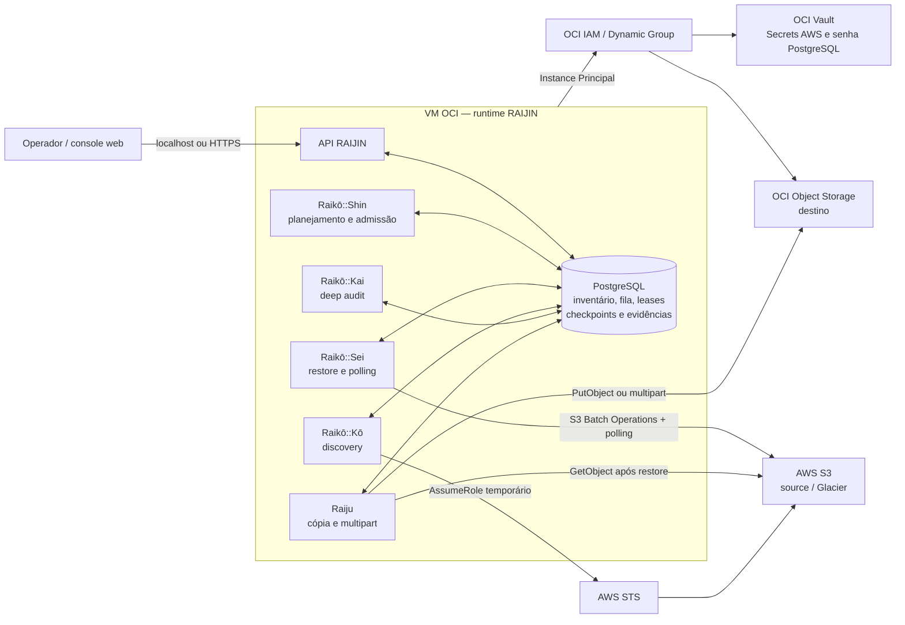
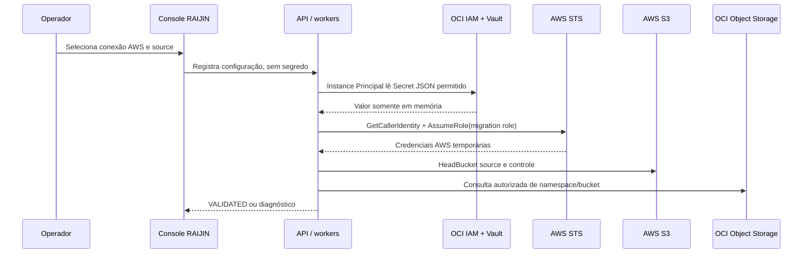
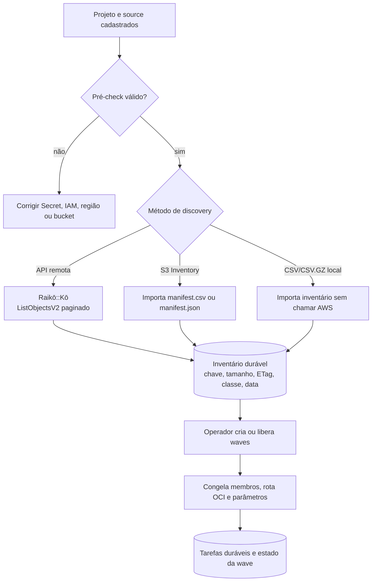
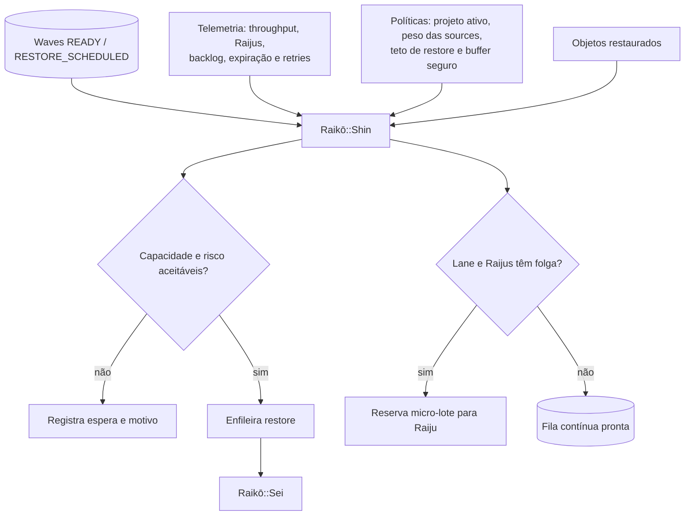
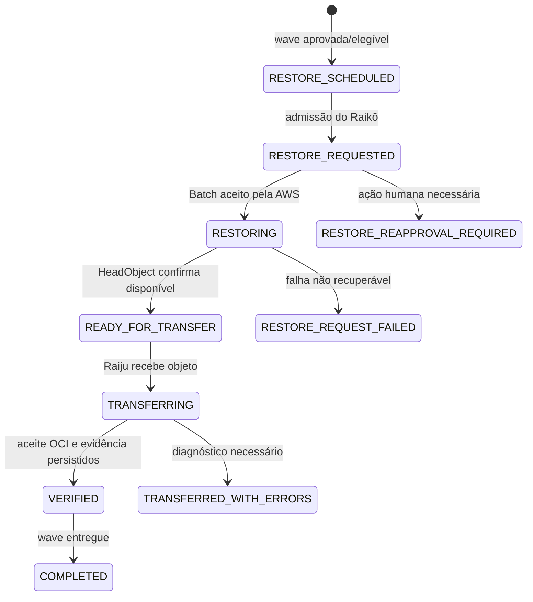
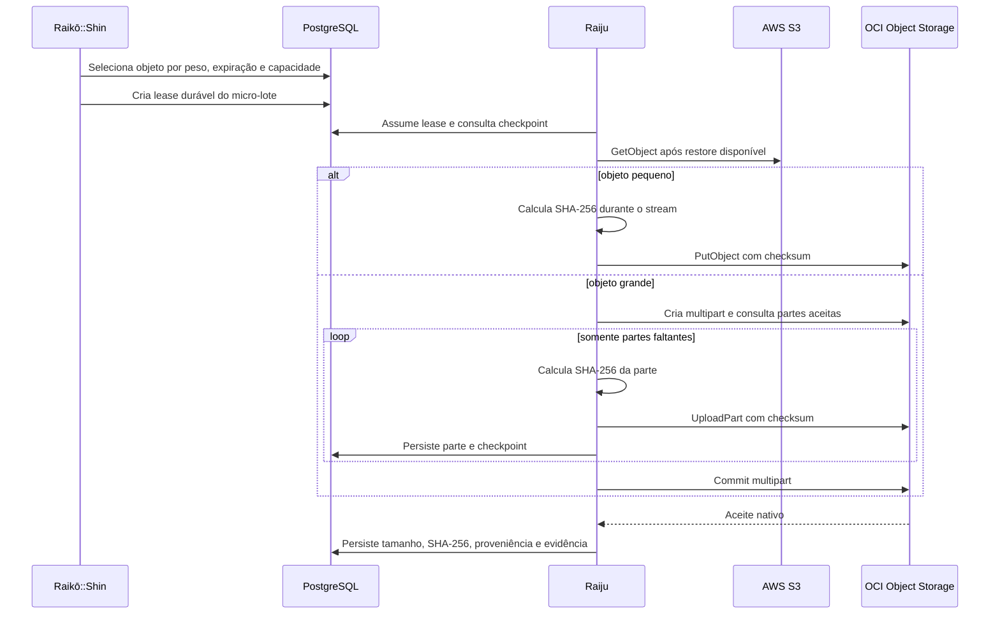
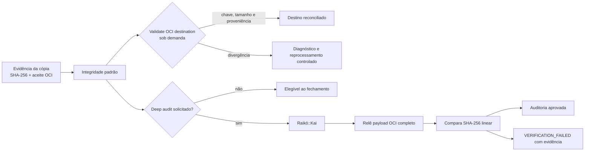
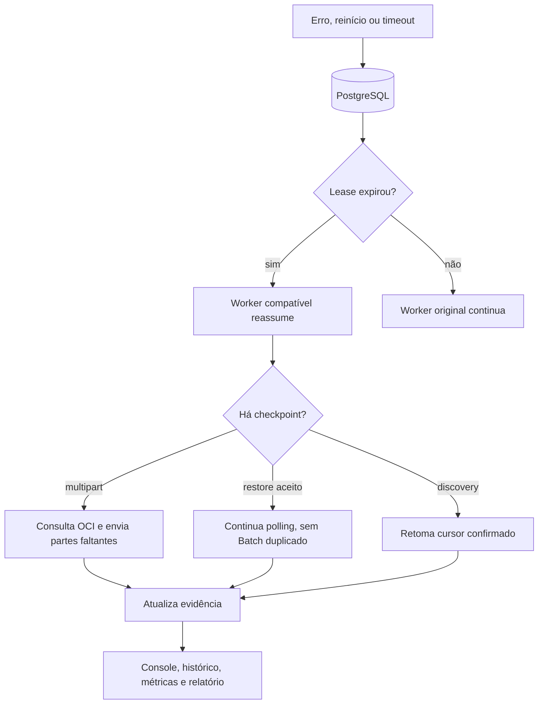

# RAIJIN — fluxo operacional, acessos e evidências

Este documento descreve o runtime **RAIJIN real/local** implementado hoje. O
navegador é apenas uma console de operação: não recebe credenciais e não chama
AWS ou OCI diretamente. O estado, a fila, os checkpoints e as evidências ficam
no PostgreSQL.

## Visão geral

## 1. Autenticação, credenciais e pré-check

| Componente | Permissão | Limite importante |
|---|---|---|
| Navegador | Console local | Não lê Secret e não chama cloud. |
| API e workers | Instance Principal da VM | Não expõem valores de Secret em tela, API ou logs. |
| OCI Vault | `read secret-bundles` via Dynamic Group | Apenas fornece segredo em memória ao runtime. |
| AWS bootstrap | Access key dentro do Secret OCI | Apenas assume a role AWS de migração. |
| AWS migration role | Credenciais STS temporárias | Acessa source; não é a role de Batch Operations. |
| AWS Batch role | Assumida pelo serviço S3 Batch Operations | Não é assumida diretamente pelo RAIJIN. |
| OCI destino | Dynamic Group limitada aos buckets permitidos | Não grava fora da policy OCI. |

O pré-check é não destrutivo: valida identidade, `AssumeRole`, buckets e OCI,
mas não lista objetos de source, não submete restore e não transfere dados.

## 2. Discovery, inventário e waves

- O discovery remoto persiste checkpoints; após falha, retoma do cursor salvo.
- Re-discovery exige justificativa e não reescreve histórico de objeto já em wave.
- A rota OCI é congelada para os objetos planejados; mudança posterior de
  configuração não desloca dados que já estão no fluxo.

## 3. Planejamento e admissão

As decisões são persistentes e auditáveis. O navegador não decide admissão: o
Raikō registra prioridade, capacidade, previsão, motivo e lease. Sem estatística
suficiente em um projeto novo, o comportamento inicial é conservador e limita
concorrência de restores até haver telemetria confiável.

## 4. Restore e janela temporária

1. Raikō::Sei gera o manifesto e submete uma única operação S3 Batch por wave.
2. A tentativa, job, região, manifesto, resposta AWS e erros ficam persistidos.
3. O polling observa `x-amz-restore` apenas nos objetos ainda pendentes.
4. A expiração é a data retornada e observada no S3, nunca uma estimativa local.
5. Objetos disponíveis podem entrar progressivamente na lane, conforme política.

## 5. Cópia, multipart e integridade padrão

- O SHA-256 é calculado durante a leitura; ETag não é tratado como MD5 universal.
- O OCI valida checksum antes de aceitar o objeto ou cada parte multipart.
- Metadados compatíveis, tags e proveniência são preservados.
- Após reinício, o Raiju consulta partes aceitas e envia somente as faltantes.
- Leases expirados são reassumíveis; checkpoints evitam falso "concluído".

## 6. Validação, deep audit e fechamento

A reconciliação normal não relê payload e não chama AWS: compara chave, tamanho e
proveniência no destino. Deep audit é opcional e intensivo em I/O; requer
confirmação explícita e pode ser pausado/retomado sem bloquear restore ou cópia.

## 7. Recuperação e rastreabilidade

O RAIJIN preserva tarefas, tentativas AWS, jobs Batch, polling, decisões,
leases, checkpoints, checksums, erros e transições. Ele não remove
automaticamente objetos de S3 ou OCI; reprocessamento e deep audit são ações
explícitas e auditáveis.

## Checklist operacional

1. Validar Instance Principal, policies OCI e Secrets.
2. Cadastrar a conexão AWS e executar pré-check.
3. Criar source, selecionar destino autorizado e executar discovery.
4. Criar/aprovar waves e acompanhar decisões do Raikō.
5. Monitorar restores, expiração, backlog e Raijus.
6. Confirmar evidências e executar validação OCI ao final.
7. Usar deep audit apenas quando a releitura integral for justificada.
8. Emitir pacote de fechamento com as evidências consolidadas.

## Referências

- [Architecture](architecture.md)
- [Capabilities](capabilities.md)
- [AWS connections](aws-connections.md)
- [Deployment](deployment.md)
- [Validation test plan](validation-test-plan.md)
- [Recovery runbook](recovery-runbook.md)
