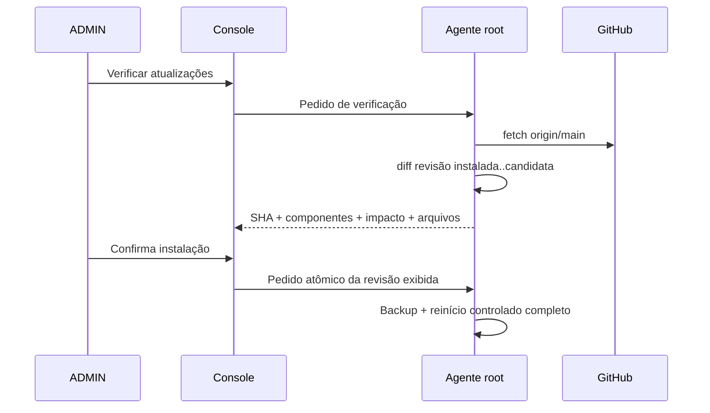
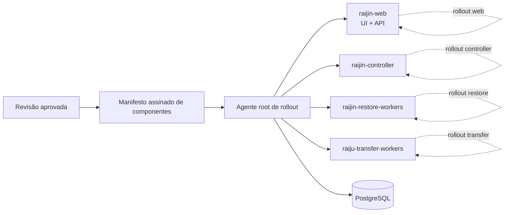

# Plano — impacto de atualização e rollout seletivo

## Objetivo

Dar visibilidade confiável do impacto de cada revisão antes de sua instalação
e, em uma segunda fase, permitir atualizar somente componentes isolados sem
interromper transferências que não dependam deles.

## Princípio de segurança

Uma classificação de arquivos não é autorização para um rollout parcial. A
Fase 1 informa o impacto, mas mantém backup e reinício controlado completos.
Somente a Fase 2 cria a separação técnica que torna uma atualização parcial
segura e verificável.

## Fase 1 — classificação e transparência

### Fluxo

### Contrato do agente

O arquivo de estado sanitizado inclui:

- `classification`: `WEB_UI_ONLY`, `DOCUMENTATION_ONLY`, `FULL_PLATFORM` ou
  `UNKNOWN`;
- `components`: `WEB_UI`, `WORKERS`, `DATABASE_OR_API`, `HOST_RUNTIME` e/ou
  `DOCUMENTATION`;
- `transfer_impact`: `NONE`, `CONTROLLED_PAUSE` ou `UNKNOWN`;
- `installation_strategy`: nesta fase sempre `FULL_CONTROLLED_RESTART`;
- até 100 caminhos alterados, apenas para evidência administrativa.

### Regras conservadoras

| Alteração | Classificação | Impacto informado |
| --- | --- | --- |
| Apenas `app/static/` ou `images/` | `WEB_UI_ONLY` | Nenhuma lógica de transferência alterada. |
| Apenas documentação | `DOCUMENTATION_ONLY` | Nenhuma lógica de transferência alterada. |
| Código, scripts, imagem, dependências, Terraform ou combinação | `FULL_PLATFORM` | Pausa controlada; componentes e workers reiniciam. |

Mesmo nos dois primeiros casos, o instalador atual faz backup e reinício total.
Isso impede uma inferência incorreta de que o código web possa ser trocado em
produção sem uma fronteira de execução independente.

### Critérios de aceite

- somente o agente root calcula e grava o impacto;
- a console nunca escolhe arquivos, canal Git ou estratégia de instalação;
- o impacto aparece na página Settings e no modal de confirmação;
- todos os textos respeitam o idioma selecionado;
- um diff desconhecido é classificado como `FULL_PLATFORM`/`UNKNOWN`, nunca
  como seguro;
- a instalação continua exigindo fila drenada, backup e health check.

## Fase 2 — rollout realmente seletivo

### Arquitetura-alvo

### Pré-requisitos obrigatórios

1. Separar a imagem/processo web/API dos processos de worker.
2. Definir contratos versionados entre API, controller, workers e esquema do
   banco; compatibilidade deve ser bidirecional durante rollout.
3. Garantir que workers fazem heartbeats, checkpoint e retomada idempotente.
4. Adotar migrações de banco expansivas/compatíveis antes de qualquer remoção
   de coluna, índice ou semântica antiga.
5. Publicar um manifesto imutável por release, assinado/allowlisted pelo
   agente root, declarando componentes e requisitos de schema.
6. Implementar health checks específicos por componente e rollback por
   componente, não apenas pelo serviço monolítico.

### Política de rollout proposta

| Manifesto | Ação | Transferências |
| --- | --- | --- |
| `web` somente | Troca `raijin-web` com health check | Continuam sem interrupção. |
| `controller` | Drena decisões novas, troca controller | Transferências já despachadas continuam. |
| `restore-worker` | Drena worker, troca pool | Transferências continuam; restores aguardam. |
| `transfer-worker` | Checkpoint, substituição gradual de Raijus | Retomam de checkpoint, sem perda. |
| `database` | Janela controlada conforme compatibilidade | Política definida pelo manifesto. |
| `host/runtime` | Atualização completa | Pausa controlada. |

### Validação antes de habilitar

- teste E2E com transferências em curso durante rollout `web`;
- teste de troca gradual de Raijus com multipart e checkpoint persistido;
- compatibilidade de API e banco nas versões N/N+1 e rollback N+1/N;
- injeção de falha durante cada etapa e comprovação de rollback;
- auditoria do manifesto, componente alterado, operador, health checks e
  resultado do rollout.

## Decisão de liberação

Fase 1 pode ser habilitada imediatamente e não reduz os controles existentes.
A Fase 2 só deve ser implementada quando os pré-requisitos de isolamento,
compatibilidade e testes acima forem aceitos como contrato arquitetural.
