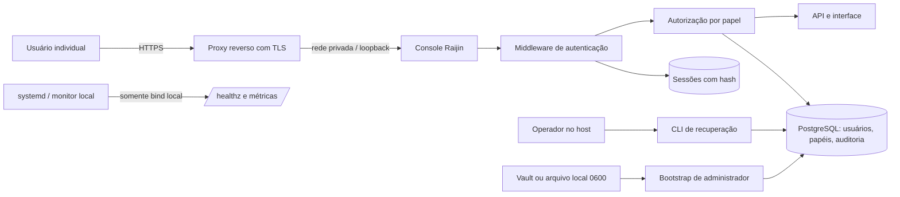
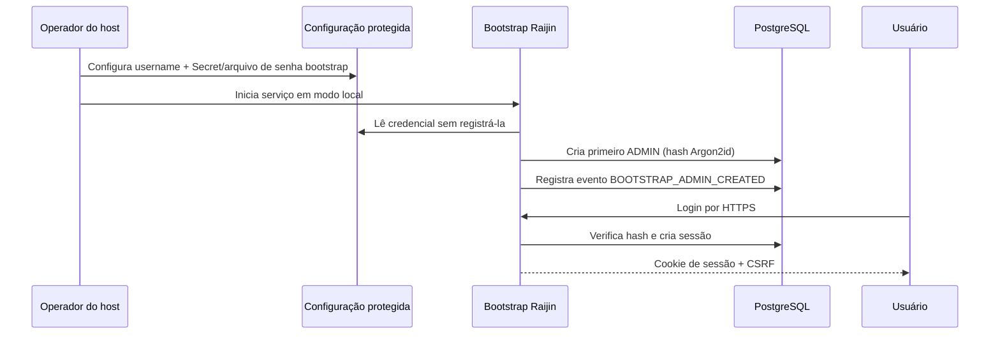

# Plano de implementação — autenticação local da console web

**Status:** planejamento. Nenhuma implementação de autenticação está autorizada por este documento.

**Objetivo:** proteger a console web do Raijin com contas locais individuais,
sessões seguras e autorização por papel, permitindo publicação atrás de um
proxy/TLS sem expor a API operacional a usuários não autenticados.

**Fora de escopo do primeiro release:** SSO/SAML/OIDC, MFA, integração LDAP,
tokens de API para terceiros e administração remota por linha de comando sem
acesso ao host.

## 1. Resultado de segurança esperado

Ao final, uma instalação em modo `local` deverá ter os seguintes limites:

- cada pessoa usa uma conta própria; senhas não são compartilhadas;
- a API, páginas HTML, WebSocket/eventos e ações administrativas exigem sessão
  válida e autorização adequada;
- senhas nunca são armazenadas, registradas em log, retornadas pela API ou
  enviadas em URLs;
- sessões são revogáveis, expiram por inatividade e usam cookies `HttpOnly`,
  `SameSite` e `Secure` quando a conexão externa usa HTTPS;
- alterações de usuários, papéis, sessão, login e bloqueio possuem trilha de
  auditoria persistente;
- `/healthz` permanece disponível somente no bind local para o systemd e
  monitoramento local; métricas não devem ganhar exposição pública por causa
  da console;
- uma recuperação de administrador continua possível apenas no host, com
  confirmação explícita e sem remover dados de migração.

## 2. Decisões de produto e gates obrigatórios

Estas decisões devem ser confirmadas antes de iniciar a fase correspondente.
O plano adota as opções recomendadas para orientar a estimativa, mas não as
considera aprovadas até confirmação explícita.

| ID | Decisão | Recomendação | Gate |
| --- | --- | --- | --- |
| D1 | Modelo de identidade | Usuários locais no PostgreSQL, com nome de usuário único e senha com hash Argon2id. | Antes de P2. |
| D2 | Papéis iniciais | `ADMIN`, `OPERATOR`, `VIEWER`. | Antes de P3. |
| D3 | Primeiro administrador | Usuário bootstrap criado a partir de Secret/arquivo protegido; nunca senha fixa ou exibida no log. | Antes de P2. |
| D4 | Transporte externo | Console exposta somente por HTTPS em proxy reverso; Raijin mantém bind local ou privado. | Antes de homologação externa. |
| D5 | Política de senha | Mínimo de 14 caracteres, bloqueio de senhas vazias/comuns e alteração pelo próprio usuário. | Antes de P2. |
| D6 | Recuperação | CLI exclusiva do host para criar/desbloquear/resetar administrador, com auditoria. | Antes de P5. |
| D7 | Migração de instalações existentes | Transição explícita `disabled → local`; nenhuma atualização ativa autenticação sem administrador configurado e testado. | Antes de P6. |
| D8 | MFA/SSO | Adiar para release posterior; preparar modelo extensível, sem implementar provedor externo agora. | Antes do encerramento do plano. |

## 3. Arquitetura proposta

### 3.1 Componentes

| Componente | Responsabilidade | Não faz |
| --- | --- | --- |
| `auth service` | Verifica senha, cria/revoga sessão, aplica expiração e lockout. | Não lê Secrets AWS/OCI. |
| middleware HTTP | Protege rotas, valida cookie/CSRF e injeta principal autenticado. | Não decide regras operacionais de migrations. |
| RBAC | Autoriza ações com base em papel e permissão declarada. | Não substitui permissões OCI/AWS. |
| bootstrap de admin | Materializa uma credencial de origem protegida e cria somente o primeiro administrador. | Não sobrescreve administrador existente. |
| CLI de recuperação | Recupera acesso a partir do host com confirmação e evento auditável. | Não fica acessível pela web. |
| auditoria | Registra ator, ação, alvo, resultado, IP encaminhado confiável e correlação. | Não registra senha, cookie ou Secret. |

### 3.2 Sessões e cookies

- Cookie opaco aleatório de no mínimo 256 bits; apenas o hash do token é
  persistido.
- Expiração por inatividade: 30 minutos recomendados; duração absoluta: 12
  horas recomendadas; ambas configuráveis com limites seguros.
- Rotação do identificador após login, alteração de senha e elevação de papel.
- `HttpOnly`, `Path=/`, `SameSite=Lax`; `Secure=true` quando
  `RAIJIN_WEB_EXTERNAL_HTTPS=true`.
- CSRF obrigatório para métodos mutáveis autenticados por cookie; cabeçalho ou
  token de formulário ligado à sessão.
- Cabeçalhos de segurança: CSP compatível com a UI, `X-Content-Type-Options`,
  `Referrer-Policy`, `Cache-Control: no-store` em login e respostas sensíveis.
- `X-Forwarded-For`/`X-Forwarded-Proto` serão aceitos apenas quando o proxy
  confiável for configurado explicitamente; nunca por padrão.

### 3.3 Papéis e permissões iniciais

| Capacidade | ADMIN | OPERATOR | VIEWER |
| --- | ---: | ---: | ---: |
| Consultar status, queue, migrations e relatórios | Sim | Sim | Sim |
| Criar/editar sources, executar discovery, waves e reprocessamentos | Sim | Sim | Não |
| Pausar/retomar filas e waves | Sim | Sim | Não |
| Criar/alterar conexões, parâmetros e modo operacional | Sim | Não | Não |
| Gerir usuários, papéis, sessões e recuperação | Sim | Não | Não |
| Visualizar auditoria de autenticação | Sim | Não | Não |

Permissões serão verificadas no servidor por endpoint/ação, não apenas por
ocultação de botões na interface.

## 4. Modelo de dados proposto

Todas as migrações são aditivas e reversíveis enquanto a autenticação estiver
em `disabled`.

| Entidade | Campos essenciais | Regras |
| --- | --- | --- |
| `console_users` | `id`, `username`, `password_hash`, `role`, `enabled`, `must_change_password`, `last_login_at`, timestamps | username normalizado e único; hash Argon2id. |
| `console_sessions` | `id`, `user_id`, `token_hash`, `csrf_secret`, `issued_at`, `last_seen_at`, `expires_at`, `revoked_at`, metadados mínimos | token nunca persiste em claro. |
| `console_login_attempts` | usuário/IP com hash, janela, resultado, bloqueio | retenção limitada; sem senha. |
| `console_auth_audit_events` | ator, tipo, alvo, resultado, correlação, origem, timestamp | imutável; payload com allowlist. |
| `console_auth_settings` | modo, expirações, proxy confiável, versão de política | singleton validado. |

Índices obrigatórios: `username`, sessão por `token_hash`, sessões ativas por
usuário, expiração/revogação e auditoria por tempo/ator.

## 5. Fluxos operacionais

### 5.1 Instalação nova

### 5.2 Instalação existente sem autenticação

1. Atualizar código com `auth_mode=disabled`; comportamento atual permanece.
2. Configurar Secret/arquivo bootstrap e executar comando de pré-validação.
3. Criar administrador e testar login por túnel, mantendo a sessão de console
   existente para recuperação.
4. Registrar evidência de sucesso e somente então mudar para `auth_mode=local`.
5. Confirmar que endpoints sem sessão retornam `401`/redirect seguro e que o
   administrador pode operar e revogar sua própria sessão em outro navegador.
6. Remover acessos temporários e registrar aceite.

### 5.3 Recuperação de acesso

1. Operador acessa a VM por SSH/Bastion.
2. Executa CLI root-only com `--confirm` para criar ou resetar um ADMIN.
3. CLI exige origem de senha protegida ou entrada sem eco; não aceita senha em
   argumento.
4. Todas as sessões do usuário afetado são revogadas.
5. CLI grava auditoria, sem registrar o valor da senha.

## 6. Plano de execução controlado

### P0 — Baseline e decisões

- [ ] Confirmar D1–D8.
- [ ] Mapear todos os endpoints HTTP, páginas, formulários, chamadas de polling,
  download/export, métricas e health checks.
- [ ] Classificar cada rota: pública local, autenticada, `ADMIN`, `OPERATOR` ou
  `VIEWER`.
- [ ] Registrar baseline de performance da UI e throughput antes de inserir
  middleware, para impedir regressão de polling ou transferência.
- [ ] Definir proxy TLS de homologação, hostname, certificado e rede confiável.

**Saída:** matriz de rotas revisada e decisões aprovadas.

### P1 — Fundamentos de segurança e configuração

- [ ] Adicionar configuração `auth_mode` com valores explícitos `disabled` e
  `local`; rejeitar valores desconhecidos.
- [ ] Definir arquivo/Secret de bootstrap por referência, seguindo o contrato
  atual `secret_ocids`/`secret_file_paths`; nunca guardar valor no JSON.
- [ ] Criar validação de configuração, limites de sessão e detecção explícita
  de proxy confiável.
- [ ] Adicionar flag externa HTTPS e validação que recuse exposição não segura
  quando `auth_mode=local` for usado fora de loopback sem proxy/TLS declarado.
- [ ] Documentar variáveis, arquivos e procedimento de rollback.

**Critério de aceite:** configuração inválida falha antes de expor HTTP; modo
`disabled` preserva integralmente o comportamento atual.

### P2 — Persistência, hash e bootstrap de administrador

- [ ] Criar modelos, migrações e índices definidos na seção 4.
- [ ] Adicionar Argon2id com parâmetros versionados e estratégia futura de
  rehash após login.
- [ ] Implementar criação idempotente do primeiro ADMIN; impedir substituição
  silenciosa de usuário existente.
- [ ] Implementar CLI root-only de pré-validação, criação e reset de admin.
- [ ] Registrar auditoria de bootstrap e recuperação.

**Critério de aceite:** nenhum hash fraco ou senha em claro no banco; processo
de bootstrap repetido não altera um administrador existente.

### P3 — Login, sessão, CSRF e RBAC no servidor

- [ ] Implementar login, logout, alteração de senha e expiração/revogação.
- [ ] Proteger rotas de HTML, API, exportações, WebSocket/SSE e ações de modo.
- [ ] Aplicar CSRF e cabeçalhos de segurança a métodos mutáveis.
- [ ] Aplicar RBAC no servidor conforme matriz P0; adicionar dependências de
  autorização reutilizáveis e testes para negação por padrão.
- [ ] Implementar limite progressivo de tentativas por usuário/origem, sem
  permitir negação de serviço global.

**Critério de aceite:** requisições sem sessão, sessão expirada, CSRF inválido
ou papel insuficiente não executam efeitos colaterais.

### P4 — Interface, usabilidade e auditoria

- [ ] Criar telas de login, logout, expiração e troca obrigatória de senha.
- [ ] Adaptar refresh automático, modais e downloads para sessão expirada sem
  loops, travamento da UI ou perda silenciosa de contexto.
- [ ] Criar gestão de usuários e sessões para `ADMIN`.
- [ ] Ocultar controles indisponíveis por papel, mantendo a verificação no
  backend.
- [ ] Criar visualização filtrável de auditoria de autenticação.
- [ ] Revisar integralmente inglês/português, mensagens de erro, tooltips e
  acessibilidade por teclado.

**Critério de aceite:** fluxo completo em ambos idiomas; nenhum polling causa
redirecionamento repetido ou página sem resposta após expiração de sessão.

### P5 — Operação, observabilidade e recuperação

- [ ] Definir logs estruturados sem credenciais e métricas agregadas de login,
  bloqueios, sessões e erros de CSRF.
- [ ] Manter `/healthz`, backup, restore, timers e scripts host-side funcionais
  sem cookie de navegador.
- [ ] Implementar documentação e exercícios de recuperação de administrador.
- [ ] Criar alertas para falhas de bootstrap de admin, picos de bloqueio e
  tentativas de acesso negadas.
- [ ] Revisar backup/restore PostgreSQL para incluir usuários, sessões e
  auditoria; definir revogação de sessões após restauração.

**Critério de aceite:** um restore não deixa sessões indevidamente válidas e
uma perda de conta administrativa pode ser recuperada apenas pelo host.

### P6 — Migração e compatibilidade

- [ ] Implementar feature flag e migração em duas releases compatíveis:
  `disabled` primeiro, `local` somente após bootstrap confirmado.
- [ ] Criar checklist de upgrade para host padrão, host via Bastion e ambiente
  de homologação.
- [ ] Validar rollback de código sem apagar tabelas nem desativar acesso do
  administrador involuntariamente.
- [ ] Testar bind `127.0.0.1`, IP específico e `0.0.0.0` atrás de proxy TLS.
- [ ] Testar Secret Vault e fallback local de bootstrap de administrador,
  incluindo a migração de arquivo local para OCID.

**Critério de aceite:** instalações existentes permanecem acessíveis até a
ativação explícita; instalações novas podem iniciar diretamente por Vault ou
arquivo local protegido.

### P7 — Verificação, hardening e promoção

- [ ] Testes unitários para hash, sessão, CSRF, RBAC, lockout e parsing de
  configuração.
- [ ] Testes de integração para todas as rotas classificadas em P0 e para
  polling simultâneo da console.
- [ ] Testes E2E de login, expiração, logout, revogação, troca de senha,
  recuperação host-side e auditoria.
- [ ] Testes de carga focados em login/polling, comparados ao baseline P0.
- [ ] Revisão de segurança de dependências e análise manual de exposição de
  Secrets, cookies, logs, CORS, redirects e proxy headers.
- [ ] Homologação em VM isolada, seguida por pré-produção controlada com plano
  de rollback aprovado.

**Critério de aceite:** todos os controles listados passam; nenhum achado
crítico/alto fica aberto; aceite operacional e de segurança registrado.

## 7. Matriz inicial de testes negativos

| Caso | Resultado obrigatório |
| --- | --- |
| Senha errada | Resposta genérica, evento auditável, sem enumeração de usuário. |
| Usuário desabilitado | Sem sessão; auditoria de tentativa negada. |
| Cookie alterado/revogado | `401` ou login; nenhuma ação executada. |
| CSRF ausente/inválido | `403`; nenhuma mutação. |
| VIEWER chama ação de queue | `403`; nenhum task/wave alterado. |
| Sessão expirada em polling | UI apresenta login uma vez, sem loop ou congelamento. |
| Proxy header de origem não confiável | Ignorado. |
| Erro de Vault/arquivo bootstrap | Serviço falha de modo claro antes de ativar auth local sem ADMIN. |
| Restore de banco antigo | Sessões inválidas/revogadas segundo a política definida. |
| Reset host-side | Revoga sessões anteriores e registra auditoria. |

## 8. Estratégia de desenvolvimento e promoção

- O trabalho será feito em branch dedicada, sugerida
  `feature/web-console-authentication`; `main` continua atendendo a versão
  atual com correções independentes.
- A primeira integração ocorrerá em ambiente de desenvolvimento isolado, com
  banco, porta e Secret próprios. Nunca usar o PostgreSQL da homologação atual
  durante refatoração incompleta.
- A imagem futura recebe tag distinta, por exemplo
  `localhost/s3-oci-migration:web-auth-dev-<revision>`.
- Homologação usa cópia de banco vazia/sintética primeiro e somente depois a
  VM de homologação designada, com backup lógico confirmado antes de mudar
  `auth_mode`.
- Promoção para a VM via Bastion só ocorre após P7 completo e aprovação
  explícita; o plano de rollback mantém `auth_mode=disabled` e a imagem
  anterior disponível.

## 9. Critério de conclusão do plano

O plano só poderá ser marcado como concluído quando cada checkbox de P0–P7
estiver respaldado por implementação, evidência automatizada e evidência
operacional. Se qualquer validação divergir, o item volta a aberto e a
implementação retorna à etapa correspondente.
